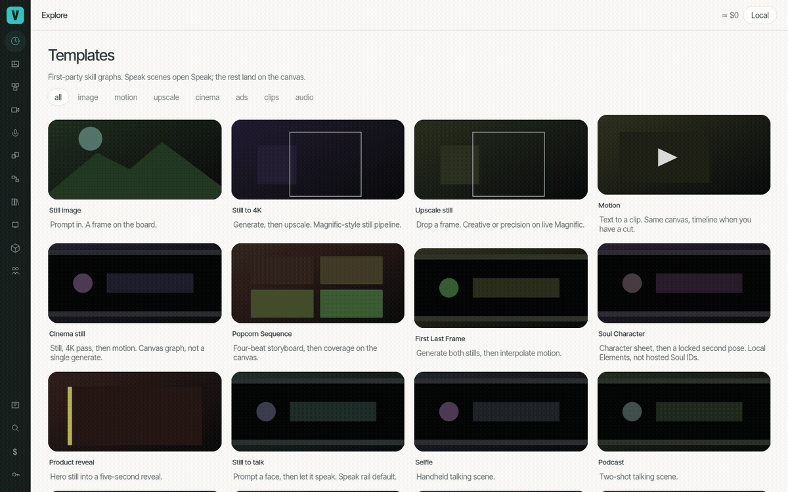
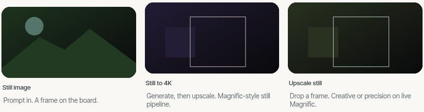
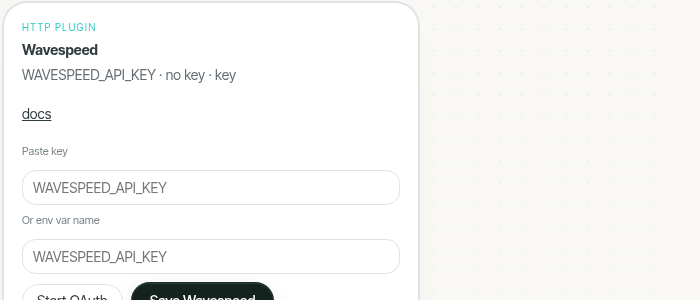

# Vinci

**Make ads, films, and shorts with every AI model in one place.** Vinci is a free, open-source studio that runs on your own machine. Marketers ship product spots and campaign assets, filmmakers develop scenes and previs, creators turn long footage into daily shorts. You keep your keys, your files, and your budget.



[](LICENSE)
[](docs/quickstart.md)
[](docs/SELF_HOST_CLOUDFLARE.md)

## What you can make

Real workflows ship in the box, ready to run:

- **Product and brand spots.** Turn one product photo into a 5-second reveal clip for a hero page, a launch post, or an ad.
- **Shorts from long footage.** Point Vinci at a podcast episode, stream, or webinar and get back vertical clips with burned-in captions, cut and reframed automatically.
- **Scene development.** One prompt becomes a connected shot sequence: establishing shot, coverage, close-up, reverse, with the same character carried through every frame.
- **Talking photos and presenters.** Animate a still into a talking take, lipsync dialogue to audio, or test an idea before you book a shoot day.
- **Finishing touches.** Upscale stills and clips to 4K, reframe anything to 9:16, burn captions, clone a voice, generate speech.



Every one of these is an installable skill, so the community can add more and you can build your own.

## What it replaces, and how it saves money

Most teams stitch together one subscription per task. Vinci is one studio instead of that stack. Current list prices on each vendor's own pricing page (checked October 2026):

- AI video generation subscriptions: Runway starts at **$12/month** ([runwayml.com/pricing](https://runwayml.com/pricing)). Vinci talks to the same class of models through your own provider accounts, at per-generation API rates, with no subscription.
- AI presenters and talking avatars: HeyGen Creator is **$29/month** ([heygen.com/pricing](https://www.heygen.com/pricing)). Vinci's talking photo, lipsync, and voice skills cover the everyday cases.
- Podcast and webinar clipping: Opus Clip starts at **$15/month** ([opus.pro/pricing](https://www.opus.pro/pricing)). Vinci's podcast-to-shorts workflow transcribes locally, picks the moments, reframes to vertical, and burns captions.
- Video upscaling: Topaz Video is **$59/month** ([topazlabs.com/pricing](https://www.topazlabs.com/pricing)). Vinci routes upscales to the provider you choose, priced per clip before it runs.

Those four alone add up to **$115/month in subscriptions** before you generate anything. With Vinci there is no subscription at all: the studio is free, trying things in demo mode costs $0, and when you go live you pay providers per generation at their own API rates. Vinci shows the exact price of each job before it runs and saves a receipt for every generation, so a campaign's media cost is a number you can show a client, not a surprise.

Honest note: Vinci does not replace the model providers themselves. You still pay Wavespeed, Google, fal, ElevenLabs, Cloudflare, Higgsfield, or Magnific for what you generate. What goes away is the layer of single-purpose app subscriptions on top.

## Why Vinci

**Every provider, one studio.** Connect the accounts you already have. Keys are stored on your machine only, never sent anywhere else.


Paste an API key, or simply sign in for providers that support it (Higgsfield, Magnific). No account with Vinci, no middleman.



Then try the same shot on three different models and keep the best take. Swapping providers never changes your workflow.

## Get started in 5 minutes

You need Python 3.12+, Node 20+, and `ffmpeg` ([install help](docs/quickstart.md)). Then:

```bash
python3 -m venv .venv && source .venv/bin/activate
make install
./scripts/vinci init --demo
./scripts/vinci studio
```

Your studio opens at `http://127.0.0.1:4310/studio`, running in free demo mode. No account, no key, no cost. When you are ready for real models, open **Connect** (pictured above) and add a provider.

Then pick your path:

- **New here?** [Make your first scene](docs/first-film.md): a guided 10-minute walk from empty canvas to finished shot.
- **Full setup details:** [Quickstart guide](docs/quickstart.md), including phone and tablet access on your network.
- **Run it on your own server:** [Self-host on Cloudflare](docs/SELF_HOST_CLOUDFLARE.md).
- **Batch work from a spreadsheet:** [Google Sheets guide](docs/google-sheets.md).

## Workflows and skills

Skills are installable workflow recipes. Ship-ready today:

| Skill | What it does |
| --- | --- |
| `image-generate` | Prompt to still, any connected image model |
| `image-upscale` / `still-to-upscale` / `video-upscale` | Take stills and clips to 4K |
| `cinema-still` / `cinema-sequence` | Shot-development stills and connected sequences with camera, lens, and look controls |
| `video-generate` | Text or image to clip |
| `product-reveal-5s` | Product photo to a 5-second reveal clip |
| `still-to-talk` / `talking-photo` / `lipsync` / `emote-animate` | Make a still speak, emote, or match dialogue |
| `tts` / `voice-clone` | Text to speech, or match a reference voice |
| `podcast-to-shorts` / `clip-select` | Find the moments in long footage and cut them |
| `reframe-9x16` / `captions-burn` / `streamer-split` | Vertical reframes, burned captions, long takes into parts |

Add more with `vinci skills add`, or write your own: a skill is a small workflow graph, not a plugin SDK.

## How cost works

- **Free to try, forever.** The full Studio runs in demo mode with practice providers at $0. Every feature works; outputs are marked as mock.
- **You see the price first.** Before any live job runs, Vinci shows what it will cost. Confirm or change the model.
- **A receipt for everything.** Every generation writes a receipt, and the Studio's cost report adds them up per project.
- **Off means off.** Live spend stays disabled until you connect a key and enable it yourself (`VINCI_ALLOW_LIVE_SPEND=1`).

## What is inside

- **Studio** - the visual workspace: templates, a shot canvas, timeline, asset library, and a cost report. Also runs on Mac and Android.
- **Skills** - the workflow recipes listed above, installable and extensible.
- **CLI and API** - `./scripts/vinci run @tryvinci/image-generate` for scripts and automation.
- **MCP tools** - let an AI assistant drive the studio for you.

How it works under the hood: [`docs/VINCI_OSS_RUNTIME.md`](docs/VINCI_OSS_RUNTIME.md).

## FAQ

**Do I need to know how to code?** No. The Studio is a visual app. Everything in it also has a CLI and API for people who want that.

**What does it cost to try?** Nothing. Demo mode runs the whole studio at $0 with no account.

**What does it cost for real work?** Only what your providers charge per generation, at their API rates. Vinci adds nothing on top, shows the price before each run, and keeps receipts.

**Where do my files and keys live?** On your machine. Keys stay in `~/.vinci/keys` or your OS keychain. Media stays in your local library.

**Can I use the output commercially?** Vinci itself is MIT-licensed. Your output is governed by the terms of the provider whose model generated it.

**What do I need to run it?** A Mac or Linux machine with Python 3.12+, Node 20+, and ffmpeg. Details in the [quickstart](docs/quickstart.md).

## Package names

Packages publish as `@tryvinci/*` on npm and `vinci-core` / `vinci-runtime` / `vinci-media` / `vinci-harness` / `vinci-provider-*` on PyPI. Nothing is published yet, so run from a clone as shown above. See `NAMESPACE.md`.

The hosted product, **Vinci Platform**, is a separate codebase. Canonical source tree: `apps/vinci-oss/` in `tryvinci/vinci-monorepo`, split-synced here.

## Contributing

MIT-licensed, contributions welcome. See `CONTRIBUTING.md`. `vinci-clips` is AGPL and **must not** enter this tree: see `legal/AGPL_CLEAN_ROOM.md`.

## License

MIT
