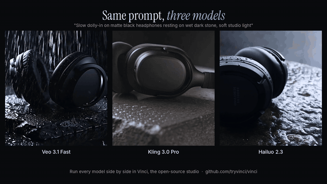
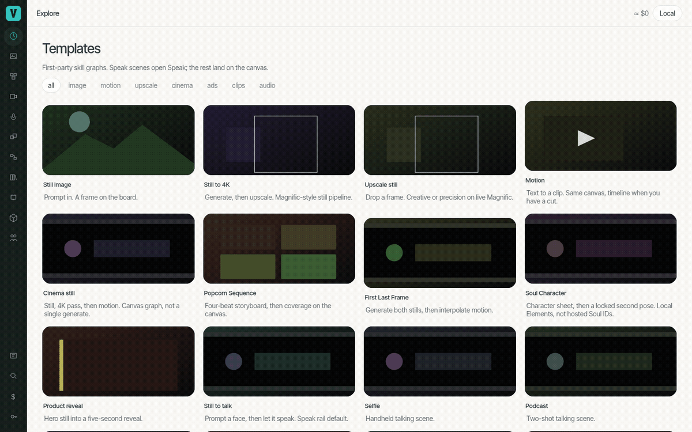
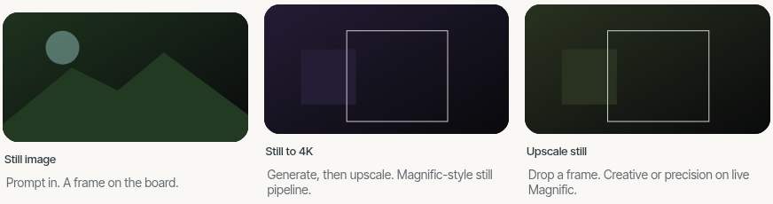

# Vinci

**The open-source studio for making ads, films, and shorts with every AI model.**

Run Veo 3.1, Kling 3.0, Seedance 2.0, Nano Banana, GPT Image 2, Flux 2, and ElevenLabs side by side on your own machine, with your own keys. An open alternative to Higgsfield, Runway, and Opus Clip.

[](https://github.com/tryvinci/vinci/stargazers)
[](LICENSE)
[](https://github.com/tryvinci/vinci/releases)
[](https://github.com/tryvinci/vinci/discussions)

[Quickstart](#get-started-in-5-minutes) · [Skills](#workflows-and-skills) · [Models](#models-and-providers) · [Docs](docs/quickstart.md) · [Contributing](CONTRIBUTING.md)



New models land here soon after they ship. Star the repo to follow along, and to help other people find it.

## What you can make

Real workflows ship in the box, ready to run:



- **Product and brand spots.** Turn one product photo into a 5-second reveal clip for a hero page, a launch post, or an ad.
- **Shorts from long footage.** Point Vinci at a podcast episode, stream, or webinar and get back vertical clips with burned-in captions, cut and reframed automatically.
- **Scene development.** One prompt becomes a connected shot sequence: establishing shot, coverage, close-up, reverse, with the same character carried through every frame.
- **Talking photos and presenters.** Animate a still into a talking take, lipsync dialogue to audio, or test an idea before you book a shoot day.
- **Finishing touches.** Upscale stills and clips to 4K, reframe anything to 9:16, burn captions, clone a voice, generate speech.



## Get started in 5 minutes

Everything below runs in free demo mode first: no account, no key, no cost.

You need Python 3.12+, Node 20+, and `ffmpeg` ([install help](docs/quickstart.md)). Install takes about a minute:

```bash
git clone https://github.com/tryvinci/vinci && cd vinci
python3 -m venv .venv && source .venv/bin/activate
make install
./scripts/vinci init --demo
./scripts/vinci studio
```

Your studio opens at `http://127.0.0.1:4311`. When you are ready for real models, open **Connect** and add a provider key.

Then pick your path:

- **New here?** [Make your first scene](docs/first-film.md): a guided 10-minute walk from empty canvas to finished shot.
- **Coming from Higgsfield or Magnific?** [Demo walkthrough](docs/demo-walkthrough.md): the same jobs in Vinci, segment by segment.
- **Full setup details:** [Quickstart guide](docs/quickstart.md), including phone and tablet access on your network.
- **Run it on your own server:** [Self-host on Cloudflare](docs/SELF_HOST_CLOUDFLARE.md).
- **Batch work from a spreadsheet:** [Google Sheets guide](docs/google-sheets.md).

## Why Vinci

**Every provider, one studio.** Connect the accounts you already have, then try the same shot on three different models and keep the best take. Swapping providers never changes your workflow. Keys stay on your machine and are never sent anywhere else.


**You see the price before anything runs.** Every live job shows its cost first and writes a receipt when it finishes, so a campaign's media spend is a number you can show a client.

**Workflows are small files you can read.** A skill is a short YAML graph, not a plugin SDK. Here is the product reveal, trimmed:

```yaml
# skills/product-reveal-5s/workflow.yaml
nodes:
  - id: still
    type: generate
    capability: t2i          # any connected image model
    params: { prompt: "{{inputs.prompt}}" }
  - id: reveal
    type: generate
    capability: i2v          # any connected video model
    params: { prompt: "{{inputs.prompt}}", image: "{{nodes.still.output}}", duration: 5 }
edges:
  - { src: still, dst: reveal, input_key: image }
```

Run it from the Studio, or from a script:

```bash
./scripts/vinci run @tryvinci/product-reveal-5s --input '{"prompt":"matte black headphones on wet stone"}'
```

**Your AI assistant can drive it.** Vinci ships an MCP server, so Claude, Cursor, or any MCP client can plan shots, run skills, and fetch results. `./scripts/vinci mcp print-config` prints the config to paste in.

## Models and providers

Bring a key for any of these, or sign in where the provider supports it (Higgsfield, Magnific). The catalog holds 90+ models today.

| Provider | Highlights |
| --- | --- |
| Google | Veo 3.1, Gemini Flash Image (Nano Banana) |
| Wavespeed | Seedance 2.0, Kling 3.0, Hailuo 2.3, Wan 2.6, Nano Banana Pro |
| Magnific | Kling 3, Seedance 2, FLUX.2, Seedream 5.0, Mystic, upscalers |
| fal | Veo 3.1 Fast, Kling 2.6, Nano Banana Pro, FLUX.1, Ideogram v3 |
| Higgsfield | DoP, Kling 2.5, Hailuo 02, Seedance, Nano Banana |
| OpenAI | GPT Image 2 and 2.5 |
| ElevenLabs | Multilingual v2, Flash v2.5, instant voice cloning |
| Cloudflare | FLUX.1 Schnell on Workers AI |

Missing a model you want? [Open an issue](https://github.com/tryvinci/vinci/issues) or add it: each provider's catalog is one JSON file (see [CONTRIBUTING](CONTRIBUTING.md)).

## Workflows and skills

Ship-ready today:

| Skill | What it does |
| --- | --- |
| `image-generate` | Prompt to still, any connected image model |
| `image-upscale` / `still-to-upscale` / `video-upscale` | Take stills and clips to 4K |
| `cinema-still` / `cinema-sequence` | Shot-development stills and connected sequences with camera, lens, and look controls |
| `video-generate` | Text or image to clip |
| `product-reveal-5s` | Product photo to a 5-second reveal clip |
| `still-to-talk` / `talking-photo` / `lipsync` / `emote-animate` | Make a still speak, emote, or match dialogue |
| `tts` / `voice-clone` | Text to speech, or match a reference voice |
| `podcast-to-shorts` / `clip-select` | Find the moments in long footage and cut them |
| `reframe-9x16` / `captions-burn` / `streamer-split` | Vertical reframes, burned captions, long takes into parts |

Add more with `vinci skills add`, or write your own and send a pull request.

## What it replaces, and what it costs

Most teams pay for one app per task: Runway from $12/month, HeyGen Creator at $29/month, Opus Clip from $15/month, Topaz Video at $59/month (list prices on each vendor's pricing page, checked October 2026). That is $115/month before you generate anything.

Vinci has no subscription. The studio is free, demo mode costs $0, and live work is billed by your providers per generation at their own API rates. Vinci adds nothing on top.

Honest note: Vinci does not replace the model providers themselves. You still pay Wavespeed, Google, fal, ElevenLabs, Cloudflare, Higgsfield, or Magnific for what you generate. What goes away is the layer of single-purpose app subscriptions on top.

- **Free to try, forever.** The full Studio runs in demo mode with practice providers at $0. Outputs are marked as mock.
- **Off means off.** Live spend stays disabled until you connect a key and enable it yourself (`VINCI_ALLOW_LIVE_SPEND=1`).

## What is inside

- **Studio**: the visual workspace with templates, a shot canvas, timeline, asset library, and a cost report. Also runs on Mac and Android.
- **Skills**: the workflow recipes above, installable and extensible.
- **CLI and API**: `./scripts/vinci run @tryvinci/image-generate` for scripts and automation.
- **MCP server**: lets an AI assistant drive the studio.
- **Movie engine (preview)**: build the world once, render every episode. Write the show bible once (characters, places, props, style), then seasons, episodes, scenes and shots, in the open [Open Lore Format](packages/olf/SPEC.md). In the Studio, **Shows** turns each scene into a storyboard: render a shot (price first, $0 in demo mode), approve takes, and see which takes are out of date after you change the bible. **Camerawork** gives a shot a camera move from a library of anime templates (track up, quick zoom, shake, held drawing); many of them need no video model, so the engine makes them from the keyframe for $0. The same engine runs from the CLI (`./scripts/vinci olf ...`). See [`docs/OLF_ENGINE.md`](docs/OLF_ENGINE.md).

How it works under the hood: [`docs/VINCI_OSS_RUNTIME.md`](docs/VINCI_OSS_RUNTIME.md).

## FAQ

**Do I need to know how to code?** No. The Studio is a visual app. Everything in it also has a CLI and API for people who want that.

**What does it cost for real work?** Only what your providers charge per generation. Vinci shows the price before each run and keeps receipts.

**Where do my files and keys live?** On your machine. Keys stay in `~/.vinci/keys` or your OS keychain. Media stays in your local library.

**Can I use the output commercially?** Vinci itself is MIT-licensed. Your output is governed by the terms of the provider whose model generated it.

## Community

- Ideas, questions, and things you made: [Discussions](https://github.com/tryvinci/vinci/discussions).
- Want to contribute? Start with a [good first issue](https://github.com/tryvinci/vinci/labels/good%20first%20issue). New skills and models are the easiest way in.

## Related projects

- [Vinci Clips](https://github.com/tryvinci/vinci-clips): only need to cut long videos into shorts? A smaller, self-hosted Node app that transcribes, picks clips, reframes to 9:16 and burns captions. It is a separate AGPL codebase and shares no code with this repo.
- [Vinci Scroll](https://github.com/tryvinci/vinci-scroll): a swipe-and-react video feed for testing creative with real viewers.

## Vinci for enterprises

This repo is the open core. Companies that run Vinci across teams use Vinci Enterprise, which adds a brand engine (your guidelines and voice in every generation), SSO, review gates and audit, and deployment in your own cloud with our team supporting it. Our creative studio, Vinci Studios, works on the same system.

[tryvinci.com](https://tryvinci.com) · [Talk to us](https://tryvinci.com/meet)

## Contributing and license

MIT-licensed, contributions welcome. See [`CONTRIBUTING.md`](CONTRIBUTING.md). `vinci-clips` is AGPL and **must not** enter this tree: see `legal/AGPL_CLEAN_ROOM.md`.

Packages will publish as `@tryvinci/*` on npm and `vinci-*` on PyPI; until then run from a clone. See `NAMESPACE.md`.
